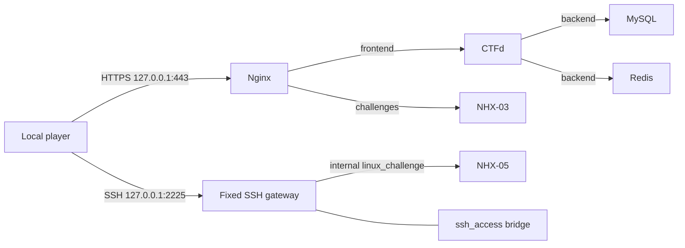

# Architecture in the approved local configuration

Static downloads: NHX-01 PNG, NHX-02 text, NHX-04 PCAP, NHX-06 ELF.
Only Nginx and the SSH gateway publish host ports, all explicitly bound to loopback.
MySQL/Redis are not published; CTFd is accessed through Nginx.

The user approved the gateway change and the source configuration is updated.
The user-run completion script verified the primary deployment: seven running services,
controlled isolation checks, challenge resets and player behavior all passed.
The vulnerable containers attach only to internal networks. The gateway forwards
exclusively to NHX-05 port 22. SSH host keys persist in a named volume. Controlled
connection tests verify backend/access-network denial before and after recreation.
